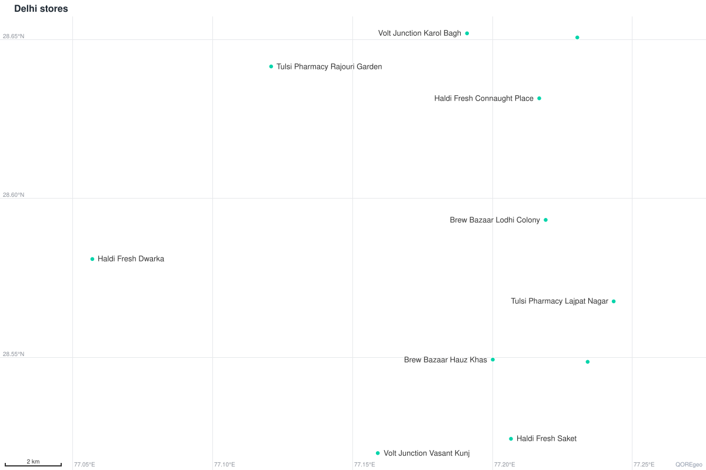

# Getting started

This page takes you from `pip install qoregeo` to your first map. You load a sample file of 30
shops, look at it, measure distances, find the nearest shop, filter, save the result, and draw
an interactive map and a static image. It ends with how to open maps in a browser and where to
read next.

Every example on this page runs as written. The test suite runs the blocks in order and
compares each `print()` with the comment next to it, so the comments show real output.

## Install

```bash
pip install qoregeo
```

qoregeo needs Python 3.10 or newer and nothing else. It has no runtime dependencies and no
compiled code, so it installs wherever Python runs, including Windows, macOS, Linux, a
Raspberry Pi and slim Docker images. On Python 3.8 and 3.9, pip installs the older 1.0.3
release instead.

Other ways to install:

| Tool | Command | What you get |
|---|---|---|
| pip | `pip install qoregeo` | the library and the `qoregeo` command in the current environment |
| uv, in a project | `uv add qoregeo` | the same, recorded in your `pyproject.toml` |
| uv, in a virtual environment | `uv pip install qoregeo` | the same as pip |
| uvx | `uvx qoregeo info stores.csv` | runs the command (or the MCP server) from a cached environment, with no install step |
| uv tool | `uv tool install qoregeo` | the `qoregeo` command on your PATH, in its own environment |
| pipx | `pipx install qoregeo` | the `qoregeo` command on your PATH, in its own environment |

`uv tool` and `pipx` install the command only. To `import qoregeo` in your own scripts, use pip
or `uv add`.

Check that it works:

```bash
qoregeo --version
python -c "import qoregeo; print(qoregeo.__version__)"
```

Both print the installed version. If your shell can't find `qoregeo` (a Scripts folder that is
not on PATH is common on Windows), run `python -m qoregeo` instead: it is the same command.

### What you get

One install gives you all of these:

| Part | Start with | Read more |
|---|---|---|
| Python library | `from qoregeo import GeoEngine` | [API reference](api-reference.md) |
| Command line tool | `qoregeo --help` | [Command line](cli.md) |
| MCP server for AI assistants | `qoregeo mcp` | [AI integration](ai-integration.md) |
| Agent Skill for Claude Code, Codex and Gemini CLI | `qoregeo skill install` | [AI integration](ai-integration.md) |
| Tool schemas for the Claude and OpenAI APIs | `qoregeo tools --format anthropic` | [AI integration](ai-integration.md) |
| Static PNG and SVG renderer | `geo.image("map.png")` | [Static images](images.md) |
| Geocoder (Nominatim or Photon) | `from qoregeo import Geocoder` | [Geocoding](geocoding.md) |

Only geocoding goes online. Loading, measuring, filtering, saving and drawing images all work
without a network. An interactive map is a single HTML file; the browser downloads Leaflet and
the basemap tiles when you open it.

## Get the sample files

The examples use small files from [docs/data](data/):

| File | Rows | What it holds |
|---|---|---|
| [stores.csv](data/stores.csv) | 30 | fictional shops in Delhi, Mumbai and Bengaluru: `name`, `city`, `category`, monthly `revenue` |
| [customers.csv](data/customers.csv) | 40 | customers around central Delhi: `id`, `segment`, `orders` |
| [zones.geojson](data/zones.geojson) | 3 | delivery-zone polygons in Delhi: `name`, `fee`, `note` |
| [messy.csv](data/messy.csv) | 7 | depots with broken coordinates, for the last section |

Clone the repository and work in that folder:

```bash
git clone https://github.com/bosekarmegam/qoregeo.git
cd qoregeo/docs/data
```

Or download a single file:

```bash
curl -O https://raw.githubusercontent.com/bosekarmegam/qoregeo/main/docs/data/stores.csv
```

Run the examples from the folder that holds the files. They load them by bare name.

## A five-minute walkthrough

### 1. Load a file

```python
from pathlib import Path

from qoregeo import GeoEngine

geo = GeoEngine()
geo.load("stores.csv")
print(geo)  # <GeoEngine [30 features]>
```

`load()` reads CSV, TSV and GeoJSON files. It finds the coordinate columns by name (`latitude`,
`lat`, `y`, `longitude`, `lng`, `lon`, `x` and a few more, in any case) and turns each row into
a GeoJSON Feature:

```python
first = geo.get_features()[0]
print(first["geometry"])  # {'type': 'Point', 'coordinates': [77.2167, 28.6315]}
print(first["properties"]["name"])  # Haldi Fresh Connaught Place
print(repr(first["properties"]["revenue"]))  # '412000'
```

Two things to notice:

- GeoJSON stores a position as `[lng, lat]`. Everywhere else in the Python API a point is a
  `(lat, lng)` tuple.
- CSV values stay strings, like `'412000'`. Filters and sorting still compare them as numbers
  when you pass a number, so you rarely need to convert. When you want real numbers and
  booleans in the properties, load with `infer_types=True`:

```python
typed = GeoEngine().load("stores.csv", infer_types=True)
print(repr(typed.get_features()[0]["properties"]["revenue"]))  # 412000
```

If your coordinate columns have other names, name them:
`geo.load("depots.csv", lat_col="y_coord", lng_col="x_coord")`. See [Loading and saving
data](data.md) for delimiters, encodings and GeoJSON input.

### 2. Look at the data

```python
print(geo.count())  # 30
print(geo.bounds())  # {'min_lat': 12.8452, 'max_lat': 28.6519, 'min_lng': 72.8147, 'max_lng': 77.75}
print(geo.bbox())  # [72.8147, 12.8452, 77.75, 28.6519]
print(geo.centroid())  # (20.730208, 75.856517)
```

A `GeoEngine` is also a sequence of Feature dicts, so plain Python works on it:

```python
print(len(geo))  # 30
print(sorted({f["properties"]["city"] for f in geo}))  # ['Bengaluru', 'Delhi', 'Mumbai']
```

| Method | Returns |
|---|---|
| `count()`, `len(geo)` | the number of features |
| `bounds()` | `{min_lat, max_lat, min_lng, max_lng}`, the keyword arguments `filter_by_bbox()` takes |
| `bbox()` | `[west, south, east, north]` in GeoJSON order; `west > east` when the data crosses 180° longitude |
| `centroid()` | the `(lat, lng)` spherical mean of all locations |
| `get_features()` | the list of Feature dicts |
| `get_geojson()` | the whole FeatureCollection dict |

From the shell, `qoregeo info` prints the same summary plus the type it finds in each column:

```bash
qoregeo info stores.csv
```

```text
stores.csv: 30 features
  geometry : Point × 30
  bbox     : west 72.8147, south 12.8452, east 77.75, north 28.6519
  centre   : 20.730208, 75.856517
  columns  : name (str), city (str), category (str), revenue (int)
```

### 3. Measure distances

```python
connaught_place = (28.6315, 77.2167)
india_gate = (28.6129, 77.2295)

print(geo.distance(connaught_place, india_gate))  # 2.4163  km, the default unit
print(geo.distance(connaught_place, india_gate, unit="m"))  # 2416.2959
print(geo.bearing(connaught_place, india_gate))  # South-Southeast
print(geo.bearing(connaught_place, india_gate, as_degrees=True))  # 148.86
```

Distances don't need loaded data; `GeoEngine().distance(a, b)` works on an empty engine. Over a
longer route the choice of Earth model starts to show:

```python
delhi = (28.6139, 77.2090)
mumbai = (19.0760, 72.8777)

print(geo.distance(delhi, mumbai))  # 1148.0965  haversine, on a sphere
print(geo.distance(delhi, mumbai, method="vincenty"))  # 1144.5264  on the WGS84 ellipsoid
print(geo.distance(delhi, mumbai, unit="miles"))  # 713.3941
```

The default `haversine` method uses a sphere with the mean Earth radius (6371.0088 km).
`vincenty` uses the WGS84 ellipsoid. Here they differ by 3.57 km, or 0.31 %. Results are
rounded to 4 decimals in the unit you ask for: `km` (default), `m`, `miles` (or `mi`), `ft`,
`yd` or `nmi`. [Measurements](measurements.md) covers area, length, destination points and
geohashes.

### 4. Find the nearest store

```python
hit = geo.nearest(india_gate)
print(hit["feature"]["properties"]["name"])  # Brew Bazaar Lodhi Colony
print(hit["distance"])  # 2.4084
print(hit["index"])  # 6
```

`nearest()` returns a dict with the feature, its distance (in km unless you pass `unit=`) and
its position in the dataset. For more than one, use `k_nearest()`. It returns a new
`GeoEngine`, nearest first, with a `_distance` property on each feature:

```python
closest = geo.k_nearest(india_gate, k=3)
print([f["properties"]["name"] for f in closest])  # ['Brew Bazaar Lodhi Colony', 'Haldi Fresh Connaught Place', 'Loom Lane Chandni Chowk']
print([f["properties"]["_distance"] for f in closest])  # [2.4084, 2.4163, 4.1928]
```

### 5. Filter

Every filter returns a new `GeoEngine` and leaves the original alone. Start with distance:

```python
near = geo.filter_by_radius(*india_gate, radius=5)
print(near.count())  # 3
print(geo.count())  # 30  the original is unchanged
```

`filter_by_radius(lat, lng, radius)` takes the latitude and longitude as two arguments, so the
`*` unpacks the tuple. The result is sorted nearest first and has a `_distance` property, like
`k_nearest()`.

Filter on a property with `filter(column, value, op="==")`:

```python
print(geo.filter("city", "mumbai").count())  # 10
print(geo.filter("revenue", 300000, op=">=").count())  # 7
print(geo.filter("category", ["cafe", "pharmacy"], op="in").count())  # 12
print(geo.filter("name", "haldi", op="contains").count())  # 8
```

String matches ignore case, so `"mumbai"` finds `Mumbai`. A number as the value makes the
comparison numeric, which is why `revenue` works although the CSV gave strings. The operators
are `==`, `!=`, `>`, `>=`, `<`, `<=`, `in`, `not in` and `contains`.

Filters chain, and `sort_by()` and `head()` work the same way:

```python
delhi_big = (geo.filter("city", "Delhi")
                .filter("revenue", 200000, op=">")
                .sort_by("revenue", descending=True))
print(delhi_big.count())  # 6
print([f["properties"]["name"] for f in delhi_big.head(3)])  # ['Haldi Fresh Connaught Place', 'Volt Junction Karol Bagh', 'Haldi Fresh Saket']
```

For any other condition, pass a function of the properties to `where()`. Here the values are
strings, so the function converts them:

```python
small = geo.where(lambda p: int(p["revenue"]) < 100000)
print([f["properties"]["name"] for f in small])  # ['Brew Bazaar Lodhi Colony', 'Tulsi Pharmacy Fort', 'Tulsi Pharmacy Hebbal']
```

To keep what lies inside a shape (a geofence), use `filter_by_polygon()`. It takes a GeoJSON
Polygon or MultiPolygon, a Feature, a whole FeatureCollection, or a circle from `buffer()`.
Holes in polygons are respected.

```python
zones = GeoEngine().load("zones.geojson")
customers = GeoEngine().load("customers.csv")

central = zones.filter("name", "Central").get_features()[0]
print(customers.filter_by_polygon(central).count())  # 13
print(customers.filter_by_polygon(zones.get_geojson()).count())  # 30  inside any of the 3 zones

walk = geo.buffer(connaught_place, radius=3)  # a 3 km circle
print(geo.point_in_polygon(india_gate, walk))  # True
print(geo.filter_by_polygon(walk).count())  # 2
```

[Queries](queries.md) covers bounding boxes, line buffers, intersections and every operator.

### 6. Save the result

```python
near.save("near.geojson")
near.save("near.csv")

print(Path("near.csv").read_text(encoding="utf-8").splitlines()[0])  # latitude,longitude,name,city,category,revenue,_distance
print(GeoEngine().load("near.geojson").count())  # 3
```

The extension picks the format: `.geojson` or `.json`, `.csv` or `.tsv`. The CSV starts with
`latitude` and `longitude`, then every property, including the `_distance` the radius filter
added. Writes are atomic, so a failed save never leaves a half-written file, and missing
folders are created. Pass `csv_safe=True` for a CSV that people will open in Excel or Google
Sheets: text cells that start with `=`, `+`, `-`, `@`, a tab or a carriage return get a leading
`'` so they can't run as formulas. Numbers such as `-5` are left alone.

`save()` replaces an existing file of the same name, including the file you loaded, so give
results a new name.

### 7. Make an interactive map

```python
geo.map("stores.html", title="Stores")
near.map("near.html", title="Within 5 km of India Gate",
         overlays=[geo.buffer(india_gate, radius=5)])
geo.heatmap("revenue.html", title="Revenue", intensity_col="revenue")
```

`map()` writes one HTML file that draws the features with [Leaflet](https://leafletjs.com) on an
OpenStreetMap basemap. Click a feature to see its properties. `overlays` adds outlines, here
the 5 km circle. `heatmap()` draws density, weighted by a numeric column when you pass
`intensity_col`. Both print one line naming the file; create the engine with
`GeoEngine(verbose=False)` to turn that off.

| `map()` option | Default | What it does |
|---|---|---|
| `output_path` | `"map.html"` | where to write the page (never the file you loaded) |
| `title` | `"QOREgeo Map"` | the page title |
| `tiles` | `"light"` | a basemap name (see below) or your own `https://…/{z}/{x}/{y}.png` URL |
| `zoom` | `None` | with `center`: the start zoom; without: the closest zoom when fitting the data |
| `center` | `None` | a `(lat, lng)` start point; `None` fits all features |
| `overlays` | `None` | extra GeoJSON shapes drawn as dashed outlines |
| `attribution` | `None` | credit HTML, required for a custom tile URL |

To embed a map in a web app or a report, get the page as a string:

```python
page = geo.map_html(title="Stores")
print(page.startswith("<!DOCTYPE html>"))  # True
```

[Interactive maps](maps.md) has the details.

### 8. Make a static image

```python
delhi_stores = geo.filter("city", "Delhi")
delhi_stores.image("delhi.png", title="Delhi stores", labels="name")
delhi_stores.image("delhi.svg", title="Delhi stores", labels="name")
```



`image()` draws the features in pure Python, with no browser, network or basemap. The file
extension picks PNG or SVG; the default size is 1200 × 800 pixels. You get a lat/lng grid, a
scale bar and, with `labels=`, a property written next to each feature. To get the image as
data instead of a file (for an e-mail, a PDF or an AI vision model), use `to_png()` or
`to_svg()`:

```python
png = delhi_stores.to_png(width=600, height=400)
print(png[:4])  # b'\x89PNG'
print(delhi_stores.to_svg().startswith("<?xml"))  # True
```

[Static images](images.md) covers sizes, overlays and styling.

### The whole walkthrough as one chain

Loading and output methods return the engine itself, and filters return a new one, so a
pipeline reads top to bottom:

```python
(GeoEngine(verbose=False)
    .load("stores.csv")
    .filter_by_radius(28.6129, 77.2295, radius=5)
    .save("near.geojson")
    .map("near.html", title="Near India Gate", tiles="topo")
    .image("near.png", labels="name"))
print(GeoEngine().load("near.geojson").count())  # 3
```

## View a map in the browser

The default basemap comes from OpenStreetMap's tile servers. Their usage policy requires the
browser to send a `Referer` header, and browsers send none for a page opened from disk (a
`file://` address). So qoregeo serves maps from your own machine:

```python
url = geo.show(block=False, tiles="dark")  # serve in the background and carry on
print(url.startswith("http://127.0.0.1:"))  # True
geo.show(heatmap=True, intensity_col="revenue")  # in a script: serves until Ctrl+C
```

`show()` builds the page in memory, serves it at `http://127.0.0.1` on a free port, opens your
browser and returns the URL. It takes the same options as `map()` (or `heatmap()` with
`heatmap=True`).

- In a script, `show()` keeps serving until you press Ctrl+C, so make it the last line.
- In a notebook or the Python REPL, it serves in the background and returns at once.
- `block=False` serves in the background from a script too. The server stops when Python exits.

For a map you already saved, use the command line. `qoregeo serve` re-reads the file on every
reload, so you can re-run your script and press reload in the browser:

```bash
qoregeo serve stores.html
qoregeo map stores.csv -o stores.html --serve
```

Both keep serving until you press Ctrl+C. The server listens on 127.0.0.1 only and serves that
one page.

### Basemaps that work from disk

A map whose file you send to someone, or open with a double-click, needs a basemap that loads
from disk. Four of the presets do: `"topo"`, `"satellite"`, `"osm-de"` and `"none"`.

| `tiles=` | Basemap | Opened from disk |
|---|---|---|
| `"light"` (default) | OpenStreetMap with muted colors, so the data stands out | ❌ |
| `"osm"` | OpenStreetMap standard | ❌ |
| `"dark"` | OpenStreetMap with inverted colors | ❌ |
| `"humanitarian"` | Humanitarian OpenStreetMap Team style | ❌ |
| `"cyclosm"` | CyclOSM cycling map | ❌ |
| `"osm-fr"` | OpenStreetMap France style | ❌ |
| `"osm-de"` | OpenStreetMap Germany style (non-commercial and small sites) | ✅ |
| `"topo"` | OpenTopoMap, up to zoom 17 | ✅ |
| `"satellite"` | NASA Blue Marble imagery, an overview up to zoom 10 | ✅ |
| `"none"` | no basemap; nothing is downloaded | ✅ |

A ❌ map opened from disk still shows your data, on a plain gray background with a note that
explains how to view it. It requests no tiles at all, which keeps it within the tile policy.
All presets are open and need no API key. List them in Python or with `qoregeo tiles`:

```python
import qoregeo

print(list(qoregeo.tile_presets()))  # ['light', 'osm', 'dark', 'humanitarian', 'cyclosm', 'osm-fr', 'osm-de', 'topo', 'satellite', 'none']
geo.map("stores_topo.html", title="Stores", tiles="topo")  # opens from disk too
```

Two more ways to look at a map:

- **Jupyter**: a `GeoEngine` as the last expression of a cell displays as an interactive map
  (up to 20,000 features).
- **Your own web server**: upload the HTML file. Served over http or https, every preset
  basemap loads. Keep the attribution, and for heavy traffic follow the
  [tile usage policy](https://operations.osmfoundation.org/policies/tiles/).

## The same steps on the command line

Each step above has a `qoregeo` command. Points are `LAT,LNG` with no space:

```bash
qoregeo info stores.csv
qoregeo distance 28.6315,77.2167 28.6129,77.2295
qoregeo export stores.csv -o near.geojson --near 28.6129,77.2295,5
qoregeo export stores.csv -o delhi_big.csv --where "city==Delhi" --where "revenue>200000" --sort revenue --desc
qoregeo map stores.csv -o stores_topo.html --tiles topo
qoregeo map stores.csv -o revenue.html --heatmap --intensity revenue
qoregeo image stores.csv -o delhi.png --where "city==Delhi" --labels name
```

The `distance` command prints the distance and the bearing:

```text
2.4163 km  (bearing 148.86°, South-Southeast)
```

The command line loads files with `infer_types=True`, and `export` refuses to write over its
input. [Command line](cli.md) lists every command and flag.

## When something goes wrong

qoregeo errors say what was wrong, what it expected and how to fix the call. Each error class
also inherits the matching built-in exception, so `except LookupError` or `except ValueError`
catch them too:

```python
from qoregeo import ColumnNotFoundError

try:
    geo.filter("revnue", 100000, op=">")
except ColumnNotFoundError as err:
    problem = err
print(problem.column)  # revnue
print(problem.available)  # ['name', 'city', 'category', 'revenue']
print(isinstance(problem, LookupError))  # True
```

Bad rows don't stop a load. Rows with blank coordinates are skipped without a word. Rows whose
coordinates aren't numbers, or are out of range (often swapped columns), are skipped with one
warning that lists their line numbers:

```python
import warnings

with warnings.catch_warnings(record=True) as caught:
    warnings.simplefilter("always")
    depots = GeoEngine().load("messy.csv")
print(depots.count())  # 4  of 7 rows
print(len(caught))  # 1
```

| What you see | Why | What to do |
|---|---|---|
| Your points on a plain gray background with a note, and no streets | the map uses an OpenStreetMap basemap and was opened from disk | `qoregeo serve map.html`, `geo.show()`, or `tiles="topo"` |
| `ColumnNotFoundError` from `load()` | the coordinate columns have names qoregeo doesn't recognize | `geo.load("file.csv", lat_col="...", lng_col="...")` |
| `UserWarning: QOREgeo: skipped 2 row(s)` | coordinates that aren't numbers, are out of range or are swapped | fix the lines the warning names |
| `NoDataError` | nothing is loaded yet, or a filter left no features | call `load()` first; check `count()` before `nearest()` |
| `qoregeo: command not found` | the folder pip installs commands into is not on PATH | `python -m qoregeo` |
| A script never finishes after `show()` | `show()` serves until Ctrl+C | make it the last line, or pass `block=False` |

[Troubleshooting](troubleshooting.md) has more.

## Where next

| Page | What it covers |
|---|---|
| [Loading and saving data](data.md) | CSV, TSV and GeoJSON input, column detection, types, bad rows, output formats |
| [Measurements](measurements.md) | distance, bearing, destination, midpoint, area, length, geohash, units |
| [Queries](queries.md) | nearest, radius, bounding box, polygon and line filters, attribute filters, sorting |
| [Interactive maps](maps.md) | `map()`, `heatmap()`, basemaps, overlays, `show()` and serving |
| [Static images](images.md) | PNG and SVG with `image()`, `to_png()` and `to_svg()` |
| [Geocoding](geocoding.md) | addresses to coordinates and back, with Nominatim or Photon |
| [Command line](cli.md) | every `qoregeo` command and flag |
| [AI integration](ai-integration.md) | the MCP server, the Agent Skill, and Claude and OpenAI tool schemas |
| [Cookbook](cookbook.md) | complete recipes for common jobs |
| [Troubleshooting](troubleshooting.md) | errors, warnings and how to fix them |
| [API reference](api-reference.md) | every `GeoEngine` method and parameter |
| [Experiments](experiments.md) | measured accuracy and speed |
